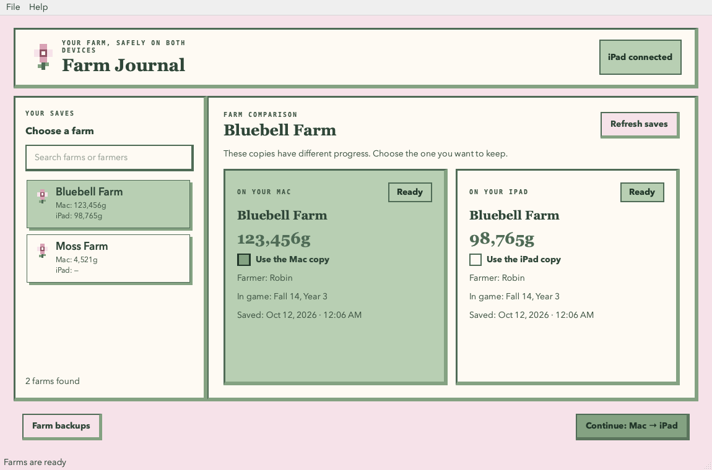

# Stardew Save Bridge

A friendly Mac app for moving a **Stardew Valley farm** between a Mac and an iPad over a USB cable. It shows each farm's name, farmer, money, and last save date, so you can choose the right copy even when you have several farms.



The app works locally. It does not need an account or cloud storage, and it never copies a farm in the background.

## Before you begin

You need a Mac running macOS 15 or newer, an iPad with Stardew Valley installed, a USB cable that transfers data, and an internet connection for the first installation. Open Stardew Valley once on each device and save your farm. Close the game on **both** devices before copying a save. [Homebrew's supported Mac requirements](https://docs.brew.sh/Installation#macos-requirements) apply to the automatic setup.

The installer gets the other software the app needs, including the iPad connection tools. It may ask for your Mac administrator password during the first setup. You do **not** need to change Mac startup security, enable a kernel extension, or install macFUSE/ifuse.

Direct USB reading has been checked with two real iPad farms. Upload, readback, replacement, and cleanup were checked with a disposable folder in Stardew Valley's shared Documents area. A full transfer confirmed inside the game still needs testing with a disposable farm. See [hardware acceptance](docs/hardware-acceptance.md) before using an irreplaceable save.

## Install

1. Download this repository with **Code → Download ZIP** above, then unzip it. If you use Git, you can instead run `git clone https://github.com/iijhay2/stardew-save-bridge.git`.
2. Open the `stardew-save-bridge` folder in Finder and double-click **Install Stardew Save Bridge.command**. Keep the Mac online and follow any installation prompts. Setup may take several minutes the first time. If macOS blocks a downloaded script, Control-click it, choose **Open**, and confirm that you trust this download.
3. The installer opens **Stardew Save Bridge.app** when it finishes. Later, open it from your home **Applications** folder (Finder → Go → Home → Applications).

The installer sets up [Homebrew](https://docs.brew.sh/Installation) if needed, installs [libimobiledevice](https://formulae.brew.sh/formula/libimobiledevice) and [ideviceinstaller](https://formulae.brew.sh/formula/ideviceinstaller) for direct iPad access, selects or installs a supported Python version, installs the app's Python packages, and builds the Mac app with its launcher icon. It builds the app on each Mac, so no separate download of its Python packages or USB tools is needed.

## Copy a farm

1. Close Stardew Valley on the Mac and iPad. Connect the iPad by USB, unlock it, and tap **Trust This Computer** if asked.
2. Open **Stardew Save Bridge** and click **Refresh saves**. Choose your farm by its name. The list shows how much money that farm has on each device.
3. Compare the two copies. Select **Use the Mac copy** or **Use the iPad copy**. This is the copy you want to keep.
4. Click **Continue**, review which device will receive the farm, and confirm. The app makes checked backups before it replaces an existing copy.
5. When the app says the farm is ready, open Stardew Valley on the receiving device and check the farm in **Load Game**.

At a narrow window size, choose a farm first and tap **All farms** to return to the list. The copy button stays visible at the bottom. The app never guesses which copy to keep from the date or money amount.

## Bring back an earlier copy

Click **Farm backups**, choose a saved farm, select **Mac** or **iPad**, and click **Continue to restore**. Review the destination and confirm. If a farm already exists there, the app saves that current copy first. Mac backups can be restored while the iPad is disconnected.

Backups stay on your Mac until you remove them. Advanced users can find them in `~/Library/Application Support/Stardew Save Bridge/`.

## If something does not appear

| What you see | What to do |
| --- | --- |
| No farms on Mac | Open Stardew Valley on the Mac, save a farm, close the game, then click **Refresh saves**. |
| iPad says it is not connected | Reconnect the cable, unlock the iPad, tap **Trust This Computer** if asked, then click **Refresh saves**. |
| Setup needs to finish | Run **Install Stardew Save Bridge.command** again. Your farms and backups are kept. |
| No iPad farms | Open Stardew Valley on the iPad and save a farm. If it still does not show up, check [iPad USB setup](docs/ipad-usb-setup.md). |
| A copy stops | Reconnect the iPad, leave Stardew Valley closed, and try **Refresh saves**. Check **Farm backups** before retrying. |

The app can read only Stardew Valley files that iPadOS makes available through File Sharing. It cannot reach private game files. See [known limitations](docs/known-limitations.md) and [recovery checks](docs/hardware-acceptance.md) for more detail.

## Update

If you downloaded a ZIP, download the latest one and run its installer. If you cloned the repository, run `git pull --ff-only` in that folder and double-click **Install Stardew Save Bridge.command** again. Your farm backups live outside the download folder.

## For contributors

The app is written in Python with [Qt for Python / PySide6](https://doc.qt.io/qtforpython-6/) and packaged locally with [PyInstaller](https://pyinstaller.org/en/stable/). Its local app uses an ad hoc signature. General distribution outside this build-on-each-Mac workflow would require Developer ID signing and notarization.

```bash
.venv/bin/python -m pip install -e '.[dev]'
PYTHONPATH=src QT_QPA_PLATFORM=offscreen .venv/bin/pytest -q
.venv/bin/ruff check src tests scripts
.venv/bin/mypy src
```

If Qt cannot find its platform plugin when running tests from the hidden `.venv` on macOS, copy `.venv/lib/python*/site-packages/PySide6/Qt/plugins/platforms/` to a normal temporary directory and set `QT_QPA_PLATFORM_PLUGIN_PATH` to that directory. The built app carries its own Qt plugins.

## Design and credits

- The colors come from this [Color Hunt palette](https://colorhunt.co/palette/f6e2e9fefaf3b8cfb384a282): `#F6E2E9`, `#FEFAF3`, `#B8CFB3`, and `#84A282`. Darker shades keep text and controls readable.
- Square borders and offset shadows are inspired by [RetroUI](https://retroui.io/). RetroUI is a React/Tailwind library; this native Qt app recreates the style and does not bundle RetroUI code.
- USB access uses the open [libimobiledevice](https://github.com/libimobiledevice/libimobiledevice) and [ideviceinstaller](https://github.com/libimobiledevice/ideviceinstaller) projects. Their licenses and installation are separate from this repository.
- The pixel flower and launcher icon were drawn for this project. Screenshots use disposable example farms. This is an unofficial Stardew Valley utility and is not affiliated with the game's creators.
